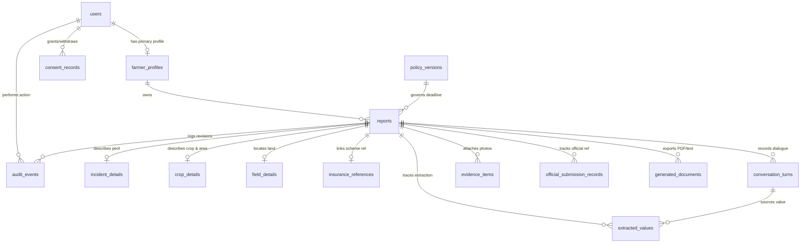

# Database Architecture & Entity-Relationship Design
**Database Engine:** PostgreSQL 16
**ORM & Migration Tool:** Prisma (`apps/api/prisma/schema.prisma` & `migrations/20261104000000_init/migration.sql`)

---

## 1. Entity-Relationship Diagram (Mermaid)

---

## 2. Core Entities (14 Required Tables + Supporting Tables)

1. **`users`**: Stores authentication (`mobile_number` hashed/masked in logs, `role` enum: `FARMER`, `FAMILY_HELPER`, `CSC_OPERATOR`, `ADMIN`, `preferred_language`, `account_status`).
2. **`farmer_profiles`**: Stores affected farmer details (`user_id`, `farmer_name`, `mobile_number`, `state`, `district`, `village`, `preferred_language`, `assisted_by_role`, `assisted_by_name`, `assisted_by_operator_id`).
3. **`consent_records`**: Tracks granular versioned consent (`AUDIO_RECORDING`, `GNANI_CLOUD_VOICE_PROCESSING`, `PERSONAL_DATA_STORAGE`, `GPS_LOCATION_CAPTURE`, `PHOTO_EVIDENCE_UPLOAD`) with `granted`, `granted_at`, `withdrawn_at`, `consent_version`.
4. **`reports`**: Core report header (`id`, `idempotency_key` unique, `farmer_id`, `created_by_user_id`, `report_number` unique e.g. `FA-2026-AP-000104`, `workflow_status`, `submission_status`, `incident_category`, `policy_version_id`, `created_at_device`, `created_at_server`, `finalised_at`, `current_revision`).
5. **`incident_details`**: 1:1 with `reports` (`incident_type`, `incident_date`, `incident_time`, `time_precision` [`EXACT`, `APPROXIMATE`, `UNKNOWN`], `crop_stage` [`STANDING`, `HARVESTED_IN_FIELD_DRYING`, `HARVESTED_STORED`, `OTHER_MANUAL_CLARIFICATION`], `harvest_date`, `event_description`, `farmer_confirmed`).
6. **`crop_details`**: 1:1 with `reports` (`crop_name`, `crop_variety`, `cultivated_area`, `affected_area`, `area_unit` [`ACRE`, `HECTARE`, `BIGHA`, `GUNTHA`], `crop_season` [`KHARIF`, `RABI`, `ZAID`], `farmer_confirmed`).
7. **`field_details`**: 1:1 with `reports` (`state`, `district`, `village`, `survey_number`, `survey_number_status` [`PROVIDED`, `MISSING_TO_COMPLETE_LATER`], `latitude`, `longitude`, `location_source` [`FARMER_SPOKEN`, `GPS_ASSISTED`, `MANUAL_ENTRY`], `location_confirmed`).
8. **`insurance_references`**: 1:1 with `reports` (`insurance_scheme` default `PMFBY`, `insured_status` [`YES_LOANEE`, `YES_NON_LOANEE`, `NO`, `UNSURE`], `application_number`, `policy_reference`, `verification_status`). **Strict Privacy Rule:** No bank account numbers or IFSC codes are stored.
9. **`conversation_turns`**: 1:N with `reports` (`turn_index`, `speaker` [`FARMER`, `ASSISTANT`, `OPERATOR`], `language`, `transcript`, `processing_status`, `provider`, `provider_mode` [`LIVE_GNANI`, `MOCK_DEVELOPMENT`, `MANUAL_TEXT`], `provider_request_id`, `created_at`). Raw audio is never stored permanently by default.
10. **`extracted_values`**: 1:N with `reports` (`field_name`, `extracted_value`, `unit`, `confidence`, `source_text`, `source_turn_id`, `confirmation_status` [`NEEDS_CONFIRMATION`, `CONFIRMED`, `CORRECTED`, `MISSING`, `APPROXIMATE`, `UNCERTAIN`], `confirmed_at`).
11. **`evidence_items`**: 1:N with `reports` (`storage_key`, `file_type`, `file_size`, `sha256_hash`, `upload_status`, `capture_time`, `latitude`, `longitude`, `farmer_confirmed`).
12. **`policy_versions`**: Configurable policy matrix (`state`, `district_scope`, `season`, `crop`, `scheme`, `loss_category`, `eligible_event_categories` JSONB, `intimation_deadline_hours` [e.g. 72], `completion_deadline_hours` [e.g. 168], `post_harvest_max_drying_days` [e.g. 14], `official_channels` JSONB, `effective_from`, `effective_until`, `source_url`, `verified_at`, `version`, `active`).
13. **`official_submission_records`**: 1:N with `reports` (`submission_channel`, `farmer_reported_submission_date`, `official_reference_number`, `acknowledgement_file_id`, `verification_status` [`FARMER_REPORTED_UNVERIFIED`, `ACKNOWLEDGEMENT_DOCUMENT_ATTACHED`, `OFFICIALLY_VERIFIED`], `created_at`).
14. **`audit_events`**: Immutable append-only audit log (`actor_id`, `actor_role`, `report_id`, `action`, `field_name`, `previous_value` JSONB, `new_value` JSONB, `reason`, `source`, `timestamp`).

---

## 3. Data Retention & Deletion Policy
- **Raw Voice Audio:** Processed in-memory for Gnani Prisma STT transcription and immediately discarded after transcript extraction unless the farmer explicitly opts into local offline retry buffering (deleted automatically once synced).
- **Right to Erasure (DPDP Alignment):** `DELETE /api/v1/reports/:reportId` and account deletion endpoints purge personal identifiers, local SQLite rows, and S3 evidence objects while recording a cryptographic deletion tombstone in `audit_events`.
